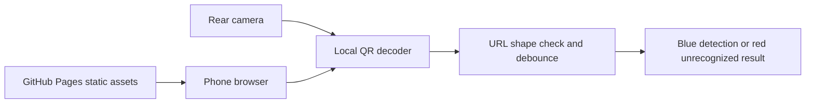

# Architecture review and next-phase decision

## Verified facts and missing evidence

The local connected `Jitu-Jose/AnnualDayQR` checkout is empty. Read-only Git access to `hnamboothiri-source/annual-day-pass-system` returned Repository not found. That response cannot distinguish a missing repository from a private repository outside the access scope. GitHub user lookup and repository creation returned Forbidden. Neither repository ownership nor source internals have been verified.

The requested volunteer functions, eight-hour sessions, sheet layout, lock behavior, token format and old QR handling are user-supplied descriptions, not inspected implementation facts. Obtain the current `Config.gs`, `Utils.gs`, `Setup.gs`, `Registration.gs`, `Approval.gs`, `WebApp.gs`, `Badges.gs`, `Dashboard.gs`, `VolunteerAuth.gs` and `VolunteerScanner.gs`, including any uncommitted versions. Request redacted configuration and synthetic records, never production PINs or attendee rows.

## Current camera-only path

There is no path to Apps Script or Sheets. A green admission confirmation is deliberately absent.

## Future integration decision — pending approval and testing

`google.script.run` does not work on an ordinary Pages origin. HTMLService is not used for the camera. Direct browser fetch integration cannot be assumed: Apps Script ContentService redirects, CORS headers, preflight behavior and deployment authentication must be measured against staging. An opaque `no-cors` response cannot acknowledge an attendance commit. JSONP, state-changing GET requests and query-string sessions are unacceptable.

A candidate small alternative is a Cloudflare Worker (free-tier eligibility and actual limits must be checked), with a strict Pages-origin CORS allowlist, POST-only login/session/action routes, body limits, rate limiting and a backend-only signing secret. It could call a staging Apps Script POST adapter server to server and follow its content redirect. The adapter must verify a timestamped authenticated envelope before dispatching to existing volunteer authorization and atomic attendance logic. Requests still require the volunteer's session and permitted role; the envelope alone is not volunteer authorization. Signing keys must live only in Worker secrets and Apps Script properties. No paid service or attendance-writing deployment is currently approved.

This is a proposal, not working integration code. A production design must decide replay prevention, failed-login storage, session expiry, redirect/body safety, idempotency, ambiguous-commit retry, cache consistency, origin protections and monitoring using the inspected source. CORS is not authentication. Retry must return the original committed result or the already-recorded timestamp. Sheet updates and activity logging must preserve consistency under lock and partial failure. Reconcile the requested eight-hour shift with actual cache TTL and eviction behavior; do not promise eight-hour sessions from a cache request alone.

Before integration: confirm exact badge URL allowlist and token grammar; audit all old web-app paths for unauthenticated write bypasses; inspect Gate/Meal authorization, active/approved eligibility, duplicate checks, throttling and lock scope; inventory all sheets and triggers. Never invoke setup/reset/migration functions. Use only a separate staging copy for integration and load tests. Backend production changes require explicit approval.
